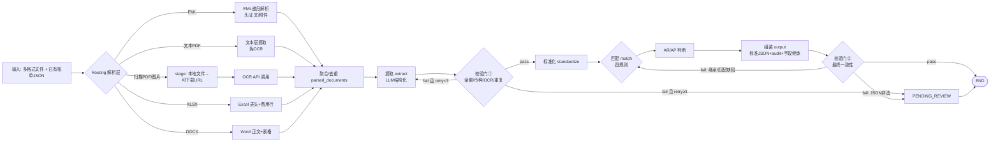
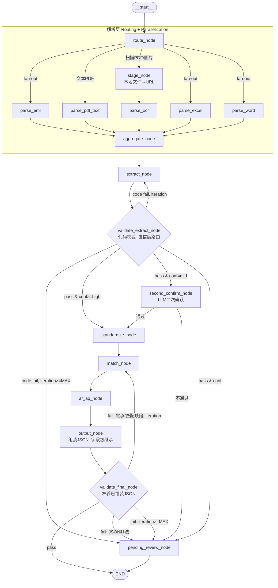

# 航运智能账单助手智能体 —— 架构方案

> 方案阶段交付物：仅架构设计，不含实现代码。技术栈锁定 **Python + LangChain + LangGraph（StateGraph 组织主流程）**，满足"python + langchain"硬性要求，并把"解析→提取→标准化→匹配→校验→输出"显式化为图。

## 0. 一页结论（TL;DR）

- **是否真的需要多智能体？** 需要。单一 LLM 无法可靠地同时处理 EML 递归解析、OCR 调度、Excel/Word 表格、四规则匹配与财务级校验——复杂度来自**异构数据源 + 财务正确性要求**，不是来自"对话开放性"。
- **主干模式**：**Prompt Chaining**（固定管线），**不是** Orchestrator-Workers（本任务步骤预定义、无动态规划需求，用它即过度设计）。
- **组合模式**：`Chaining(主干) + Routing(解析层) + Parallelization(附件/多文档) + Evaluator-Optimizer(提取-校验回路)`。
- **稳定性核心**：确定性 harness 代码控流，LLM 只在明确的任务点做决策；OCR 与 LLM 提取结果**必须过校验门**才入账；低置信统一走 `PENDING_REVIEW` 兜底。

---

## 1. 需求与复杂度分析

| 维度 | 结论 |
|------|------|
| 任务 | 多格式文档 → 解析 → 提取航运费用 → 标准化 → 匹配 → CREATE/UPDATE → AR/AP → 校验 → 标准 JSON |
| 输入 | EML / PDF(文本+扫描) / JPG·PNG·TIFF / XLS·XLSX / DOC·DOCX / 已有账单 JSON |
| 输出 | `operation / document_info / transaction_party / charge_details / financial_attributes / audit_trail` 数组 |
| 复杂度来源 | ①异构输入解析路径不同 ②EML 附件需递归解析 ③费用名/币种/付款方式需标准化 ④四规则匹配 ⑤AR/AP 需语义推理 ⑥财务级校验(金额/币种/合计/OCR纠错/去重) |
| 约束 | 单智能体"读+判+写"不可靠；OCR 走指定 API；金额必须数字、币种 ISO 4217、无法提取用 `null`、不得虚构、OCR 未校验不入账、最终必须合法 JSON |
| 验收重点 | 第 8 条（harness 稳定性/准确性）+ 第 9 条（5 点以上补充思考） |

**瓶颈定位**：解析层（异构）用 Routing 解决；质量不稳定（提取/校验）用 Evaluator-Optimizer 解决；附件/多文件延迟用 Parallelization 解决；主线步骤固定用 Chaining。

---

## 2. 推荐架构与 Agent Pattern 组合

### 2.1 为什么**不是** Orchestrator-Workers

本任务步骤是**预先定义的管线**（解析→提取→标准化→匹配→校验→输出），没有"根据输入动态拆解子任务"的需求。若引入 Orchestrator，它只是把固定任务列表分发给 Worker——这正是 review-criteria 中的 **Pattern A：Unnecessary Orchestrator** 反模式。改用 Chaining，把步骤硬编码进 harness，反而更可预测、可调试、省 token。

### 2.2 四个 pattern 各司其职

| Pattern | 用在哪 | 选择理由 |
|---------|--------|----------|
| **Prompt Chaining** | 主干管线 | 步骤固定且有依赖，每步输出是下步输入，中间可插校验门 |
| **Routing** | 解析层（按文件类型分发） | 输入类型多样、处理逻辑显著不同；用**代码规则**(MIME+扩展名+内容嗅探)而非 LLM——快、零成本、边界清晰 |
| **Parallelization (Sectioning)** | EML 附件、多文件、多费用行 | 附件/文档间无依赖，并行降总延迟；费用行分片并行（**先整单提取单据头+合计，再按合计分片提取费用行**，见 §4.2） |
| **Evaluator-Optimizer** | 提取↔校验回路 | 有明确评价标准（金额/币种/合计/OCR纠错/重复），单次生成难保证正确，迭代提升质量 |

### 2.3 架构总图（数据流）



---

## 3. LangGraph StateGraph 设计

### 3.1 状态定义（`BillState` TypedDict）

```python
from typing import TypedDict, Literal, List, Dict, Any, Annotated
from operator import add

class BillState(TypedDict, total=False):
    # ---- 输入 ----
    source_files: List[Dict[str, str]]        # [{path, mime, type}]
    existing_bills: List[Dict[str, Any]]      # 已有账单 JSON
    accounting_entity: str                    # 记账主体（AR/AP 视角基准）
    config: Dict[str, Any]                    # 阈值/重试上限/模型路由/预算

    # ---- 解析层（Routing 输出） ----
    route: str                                # 路由决策
    # 并行 fan-in 字段：用 operator.add reducer 累加，避免 Send 结果互相覆盖
    parsed_documents: Annotated[List[Dict[str, Any]], add]  # [{type, raw_text, tables, ocr_raw, source_file}]
    parse_errors: Annotated[List[Dict[str, Any]], add]

    # ---- 提取层 ----
    document_info: Dict[str, Any]             # 单据类型/编号/日期 + 提单号 bl_no/订舱号 booking_no/箱号 container_no（匹配键）
    extracted_charges: List[Dict[str, Any]]   # 原始费用项(保留原始名)，每项含 confidence
    extraction_confidence: Dict[str, float]   # {"overall": 0.9, "per_charge": {...}}
    extraction_issues: Annotated[List[Dict[str, Any]], add]  # 校验门回传缺陷(累加)

    # ---- 标准化 ----
    normalized_charges: List[Dict[str, Any]]  # 标准名 + 原始名 并存

    # ---- 匹配 ----
    match_results: List[Dict[str, Any]]       # [{charge, matched_bill, rule, operation}]

    # ---- AR/AP ----
    financial_results: List[Dict[str, Any]]

    # ---- 校验 ----
    validation_issues: Annotated[List[Dict[str, Any]], add]
    validation_status: Literal["pass", "fail"]

    # ---- 输出 ----
    output_records: List[Dict[str, Any]]
    final_status: Literal["success", "pending_review", "failed"]

    # ---- 控制（harness） ----
    iteration: int                            # 当前校验-重试轮次
    retry_count: int
    budget_consumed: Dict[str, int]           # {"tokens": 12345, "ocr_calls": 2} 预算消耗
```

> 说明：`total=False` 已使全部字段可选（无需 `NotRequired`，二者并用属冗余/错误）。并行 fan-in 字段（`parsed_documents`/`parse_errors`/`extraction_issues`/`validation_issues`）用 `Annotated[List, add]` reducer 累加，保证 LangGraph `Send` 并行结果**汇聚而非覆盖**。匹配键（`bl_no/booking_no/container_no`）落在 `document_info`，供 `match_node` 规则 2/3/4 使用。

### 3.2 节点/边图（StateGraph）



- **条件边**：`validate_extract_node` 按「代码校验结果 + 置信度」分派（重试 / 前进 / 二次确认 / 兜底）；`output_node` 先组装 JSON 并做字段级继承 merge，`validate_final_node` 校验**已组装** JSON——继承/匹配缺陷回退 `match_node`，JSON 非法直接 `PENDING_REVIEW`（确定性组装失败重跑无意义），超限走 `PENDING_REVIEW`。
- **并行扇出**：解析层用 LangGraph `Send` API 对多附件/多文件扇出到 `parse_*`；PDF/图片先经 `stage_node` 生成可下载 URL，再进 `parse_ocr`。
- **checkpointer**：生产用 `SqliteSaver`（持久化，断点续跑与审计回放成立；`MemorySaver` 进程重启即丢，仅调试用）。

### 3.3 节点职责 / 输入 / 输出 / 工具

| 节点 | 职责 | 输入 | 输出 | 工具/模型 | 权限 |
|------|------|------|------|-----------|------|
| `route_node` | 按 MIME+扩展名+内容嗅探分类 | `source_files` | `route` 决策 | **代码规则（非LLM）** | 只读 |
| `stage_node` | 本地 PDF/图片上传对象存储，生成 OCR 可下载 URL | 本地文件路径 | `file_url` | 对象存储 SDK（签名URL） | 网络出站(沙箱) |
| `parse_eml` | EML 递归解析头/正文/附件（附件按类型再路由） | `.eml` | `parsed_documents[]` | `email` 库 | 只读 |
| `parse_ocr` | 调指定 OCR API（`file`=stage 生成的下载URL） | `file_url` | `ocr_raw` | `requests` → `gateway.pltplt.com/ai/process` | 网络出站(沙箱) |
| `parse_pdf_text` | 含文本层 PDF 直接提取文本/表格（免 OCR） | 文本 PDF | `raw_text, tables[]` | `pdfplumber`/`PyMuPDF` | 只读 |
| `parse_excel` | 读工作表/表头/费用明细行 | `.xlsx/.xls` | `tables[]` | `openpyxl`/`pandas` | 只读 |
| `parse_word` | 提取正文+表格 | `.doc/.docx` | `raw_text, tables[]` | `python-docx` | 只读 |
| `aggregate_node` | 合并解析结果、跨文档去重、关联附件与父单据 | 各 parser 输出 | 统一 `parsed_documents` | 代码 | 只读 |
| `extract_node` | 提取单据类型/编号/**提单号/订舱号/箱号**/日期/签发方/接收方/费用名/数量单价金额/币种/PP·CC/小计税额总计；单据头+合计整单提取，费用行分片并行 | `parsed_documents` | `document_info + extracted_charges + 整体与逐项 confidence` | **LLM(强) + Pydantic 结构化输出** | 无 |
| `validate_extract_node` | 金额数字、ISO 4217、明细=小计、小计+税=总计、OCR `0/O`·`1/l` 纠错、重复检测；**置信度路由 + 分片完整性对账**（行数/Σ明细 vs 小计） | `extracted_charges` | `validation_issues + status + 置信度判定` | **代码(主) + LLM(辅)** | 只读 |
| `second_confirm_node` | 中等置信度(conf∈[T_low,T_high))费用的 LLM 二次确认 | 中等置信费用项+原始文本 | 确认通过/不通过 | LLM(强) | 无 |
| `standardize_node` | 费用名/币种/付款方式标准化（保留原始名） | `extracted_charges` | `normalized_charges` | 映射表 + LLM(轻) | 只读 |
| `match_node` | **四规则**匹配已有账单：①单据编号+费用名 ②提单号+费用名+币种 ③订舱号+费用名+币种 ④箱号+交易双方+日期+金额；定 `CREATE/UPDATE/NO_CHANGE` | `normalized + existing_bills` | `match_results(operation)` | 代码规则 + LLM(兜底) | 只读 |
| `ar_ap_node` | 结合记账主体/签发方/接收方/收费方向判 AR/AP | 交易方+`accounting_entity` | `financial_attributes` | **LLM(强) 语义推理** | 无 |
| `output_node` | 组装标准 JSON + `audit_trail`（文件来源/原始文本/`ai_reasoning`）；**UPDATE 时执行字段级继承 merge**（未明确修改字段继承原值） | 全部中间结果 | `output_records`（已组装 JSON） | 代码 | 只读+写输出文件 |
| `validate_final_node` | 校验**已组装 JSON**（字段完整性、UPDATE 未覆盖非明确字段、JSON 合法）；继承/匹配缺陷回退 `match_node`，JSON 非法转 `PENDING_REVIEW` | `output_records` | `validation_status` | 代码 | 只读 |
| `pending_review_node` | 低置信/校验失败兜底，产出 `PENDING_REVIEW` 记录 | 失败记录 | `PENDING_REVIEW` 记录 | 代码 | 只读 |

**模型分层（cost control）**：强模型只用于 `extract`（语义提取）、`second_confirm`（二次确认）与 `ar_ap`（推理）；轻模型用于 `standardize`（分类）以及 `validate_extract`/`match` 的**歧义兜底**（频率极低）；`route/stage/parse_*/output/pending_review` 纯确定性代码（零 LLM）。

---

## 4. Harness 工程设计（重点：验收第 8 条）

> 核心原则（harness-design.md）：**确定性代码控流，LLM 只在明确任务点决策**。整个管线走向可预测，每个节点内部才允许 LLM 自主。

### 4.1 LLM 结构化输出约束（防格式漂移）

- 用 **Pydantic 模型 + `with_structured_output`/`JsonOutputParser`**，不靠"自然语言 + 正则"解析 LLM 自由文本。
- 费用项 schema 预定义：`charge_item / quantity / unit_price / amount / currency / payment_term` 全部强类型（`amount: float`，`currency: str` 限三位）。
- 单据头 schema 预定义：`document_type / reference_no / document_date / bl_no / booking_no / container_no`——其中 `bl_no / booking_no / container_no` 是匹配规则 2/3/4 的键，必须纳入提取。
- 解析失败 → 进入**解析重试**（修格式 → 重新生成 → 仍失败 → PENDING_REVIEW），**禁止**静默降级为自由文本截取。

### 4.2 校验-重试循环（Evaluator-Optimizer 落点）

- **代码校验优先**（快、便宜、可靠）：金额 `isinstance(float)`、币种 ∈ ISO 4217 集合、`Σ明细 == 小计` 与 `小计 + 税额 == 总计`（分两条独立校验，避免把含税总计与明细金额混同）、OCR `0/O`·`1/l` 启发式纠错、重复提取检测。
- **LLM 校验补充**（语义）：合计语义是否对应、单据类型是否合理、字段是否虚构。
- 校验失败 → 把 `validation_issues` 作为**具体缺陷**回传给 `extract_node` 重试（不是让它"再想想"）。**最多 3 轮**，超限走 `PENDING_REVIEW`。循环上限是硬约束（反模式 D：无退出条件的循环）。
- **分片完整性对账**：费用行分片并行前，先整单提取「单据头 + 合计」；`validate_extract_node` 对账「分片提取行数 / Σ明细 vs 整单合计」，不一致视为丢行 → 改整单不分片重提取，仍失败 → PENDING_REVIEW。

### 4.3 置信度阈值 + PENDING_REVIEW 兜底

- `extract_node` 输出整体置信度 + **逐费用项置信度**（每项 `charge.confidence`，状态 `extraction_confidence: {overall, per_charge}`）。
- **阈值分级（已落入 StateGraph 条件边）**：`conf ≥ T_high` → 直接 `standardize`；`T_low ≤ conf < T_high` → `second_confirm_node` LLM 二次确认（通过→standardize，不通过→PENDING_REVIEW）；`conf < T_low` → 直接 `PENDING_REVIEW`。
- 低置信的单条费用行可被单独隔离复核，不影响同单据其它高置信行。
- `PENDING_REVIEW` 是**一等公民终态**（不是错误），携带失败原因 + 原始文本 + 建议修正，进入人审队列。满足"无法提取用 null""不得虚构""未校验不入账"。

### 4.4 OCR 结果校验后才入账

- **PDF 默认走 OCR（题目要求）**：`route_node` 按 `ocr.pdf_mode=always` 把所有 PDF 送 `parse_ocr`；仅当公网 staging 不可达（`ocr_delivery_ready()=False`）时才降级 `parse_pdf_text`，降级原因写入 `meta`。扫描件/图片没有文本层可降级，快速失败转 PENDING_REVIEW，不会干等 300s。
- **先 stage 后 OCR**：扫描 PDF/图片经 `stage_node` 上传对象存储、生成可下载 `file_url`，`parse_ocr` 才以 `{"file": file_url, "task": "orderChange", ...}` 调 OCR（OCR 服务端只收下载地址，本地文件直接调用是空转）。
- OCR 原始输出**先进入 `parse_ocr` 的专用校验门**：结构完整性、置信度、与已知单据格式（Debit/Credit Note 表头、提单字段）的交叉校验。
- 校验通过才把 `ocr_raw` 送入 `extract_node`；不通过则重试 OCR（API 已内置 `timeout=(10,300)` 超时），**降级**为"更低分辨率/裁剪后二次 OCR"，仍失败 → PENDING_REVIEW。
- **绝不**让 OCR 原文未经校验直达金额字段。

### 4.5 重复/冲突检测

- **重复提取**：对每条费用项计算归一化指纹 `hash(单据号 + 费用名 + 币种 + 金额)`，同指纹去重。
- **重复账单**：`match_node` 若命中已有账单且所有字段相同 → `NO_CHANGE`，不重复入账（幂等）。
- **冲突**：UPDATE 时若"输入明确要求修改的字段"与既有值冲突、或同一单据命中多张候选账单，**不静默覆盖**，转 PENDING_REVIEW。
- **同名费用争用同一账单**：一张单据两行同名费用（如两行 Handling Charge）按规则①都会命中同一张旧账单。金额唯一一致的那行认领该账单，其余行判为独立费用重新匹配（通常落 CREATE）；零条或多条金额一致 → 全部转人工。

### 4.6 可观测性

- 每个节点记录 `输入/输出/耗时/token/置信度`；全链路 **correlation_id** 贯穿"路由→解析→提取→校验→输出"。
- `audit_trail` 每条记录必含：`source_file`（文件来源）、`original_text`（原始文本片段）、`ai_reasoning`（处理依据数组），满足验收第 9 条"记录文件来源、原始文本和处理依据"。

### 4.7 七大 Harness 组件对照

| 组件 | 本方案设计 |
|------|-----------|
| **循环控制** | 校验-重试 `MAX_RETRY=3`；OCR `timeout=(10,300)`；每节点超时；断点续跑 |
| **权限系统** | 见 §4.8：auto/confirm/deny 三级强制层，harness 层拦截（非 LLM 判断），覆盖已有账单=deny |
| **上下文管理** | 子 agent 隔离：`extract_node` 只收其对应文档分片；**先整单提取单据头+合计，费用行才分片**；大文档分块 |
| **错误处理** | 四级降级：retry（OCR/LLM 超时指数退避）→ degrade（OCR 换更低分辨率/裁剪二次识别）→ skip（单文件解析失败标记后继续）→ 人工（PENDING_REVIEW） |
| **状态持久化** | LangGraph checkpointer（`SqliteSaver`）；`audit_trail` 落盘；中间结果按节点 checkpoint |
| **可观测性** | 结构化日志 + 全链路追踪 + 指标（token/延迟/错误率/置信度分布） |
| **预算/成本** | 强模型仅 extract+second_confirm+ar_ap；轻模型 standardize + validate/match 歧义兜底；其余零 LLM；OCR 缓存；**全局 token 预算**（见 §4.9） |

### 4.8 权限系统（强制层）

- **三级权限**：`auto`（只读：parser/校验/匹配/standardize）· `confirm`（`output_node` 写输出文件前确认，且只写**新文件**）· `deny`（覆盖/删除已有账单，一律拒绝）。
- **harness 层拦截**：权限检查在工具调用前由 harness `PermissionSystem` 执行，**不依赖 LLM 判断**——静态标注 ≠ 强制执行，这是评审 11b 的落点。
- **每节点独立配置**：`parse_*`/`match`/`validate` 只读；`stage_node`/`parse_ocr` 网络出站白名单（仅对象存储 + OCR 域名）；`output_node` 写权限最小化。
- **覆盖已有账单 = deny**：更新只走"字段级继承 + 追加新记录"，物理上无法覆盖原账单，从机制上满足"更新不得覆盖未明确修改字段"。

### 4.9 Token 预算与成本上限

- **全局预算**：单请求 `max_total_tokens`（如 200K），超过即触发降级。
- **每节点子预算**：`extract_node`/`second_confirm_node`/`ar_ap_node` 各自上限；校验-重试 3 轮 × 大文档 × 强模型的总成本被硬性封顶。
- **超预算行为**：降级模型（强→轻）→ 终止并 PENDING_REVIEW → 通知用户；`budget.py` 在每节点入口做**前置检查**（非事后统计）。
- **实时监控**：`budget_consumed`（tokens / OCR 调用次数）随状态推进，超阈值告警。

---

## 5. Python 项目目录 / 模块结构

```
shipping-bill-agent/
├── pyproject.toml                  # [tool.uv] package=false（非可编辑安装，规避中文路径 .pth 解码问题）
├── .env.example                    # DEEPSEEK_API_KEY / DEEPSEEK_BASE_URL
├── README.md
├── bill_agent/                     # 应用包（根包布局，非 src/）
│   ├── __init__.py
│   ├── __main__.py                 # python -m bill_agent
│   ├── main.py                     # CLI 入口：构建 StateGraph + invoke
│   ├── config.py                   # .env + config/*.yaml 加载
│   ├── config/
│   │   ├── settings.yaml           # 阈值/重试/模型/OCR/对象存储/预算
│   │   └── charge_name_map.yaml    # 费用名标准化映射(可维护字典)
│   ├── graph/
│   │   ├── state.py                # BillState TypedDict + 自定义 reducer(并行 fan-in 去重)
│   │   ├── builder.py              # 节点/边/条件边组装
│   │   └── nodes/                  # route / parse / aggregate / extract / validate_extract /
│   │       │                       # second_confirm / standardize / match / ar_ap / output /
│   │       │                       # validate_final / pending_review
│   ├── parsers/                    # 确定性解析(零LLM)
│   │   ├── eml.py                  # 递归解析 + 附件路由
│   │   ├── stage.py                # 本地文件→对象存储→可下载URL(OCR 前置，local/s3 可插拔)
│   │   ├── pdf_text.py             # 文本层 PDF 直接提取(免 OCR)
│   │   ├── ocr.py                  # 调 OCR API + 结构化响应映射(chargeList/ctrList→表格)
│   │   ├── excel.py                # .xlsx=openpyxl / .xls=xlrd
│   │   ├── word.py                 # .docx=python-docx / .doc=LibreOffice 降级
│   │   └── dispatcher.py           # MIME/扩展名路由
│   ├── extraction/
│   │   ├── schemas.py              # Pydantic 输出模型
│   │   ├── prompts.py
│   │   └── extractor.py
│   ├── validation/
│   │   ├── code_validators.py      # 金额/币种/合计/OCR纠错/重复(确定性)
│   │   └── llm_validator.py
│   ├── standardize/normalizer.py   # 映射表 + 模糊匹配
│   ├── matching/engine.py          # 四规则 CREATE/UPDATE/NO_CHANGE + 多命中冲突
│   ├── llm/
│   │   ├── router.py               # 模型路由(deepseek-chat/reasoner)
│   │   └── structured.py           # 结构化输出工厂(json_mode)
│   ├── harness/                    # harness 层
│   │   ├── logger.py               # correlation_id 结构化日志
│   │   ├── budget.py               # token/OCR 预算（extract 与 OCR 调用前强制检查）
│   │   └── error_handler.py        # 重试(指数退避)
│   └── output/schema.py            # 标准输出 JSON schema
├── samples/                        # make_samples.py + 演示样例(xlsx/json)
└── tests/                          # 确定性单测 + mock LLM 端到端
```

---

## 6. 关键设计决策与理由

1. **主干用 Chaining 而非 Orchestrator-Workers**：步骤预定义，硬编码进图更可预测/可调试/省 token（反模式 A）。
2. **路由用代码规则而非 LLM**：MIME+扩展名分类边界清晰，LLM 分类徒增延迟与成本。
3. **校验"代码优先、LLM 补充"**：金额/币种/合计/OCR 纠错是客观规则，代码判定快且可靠；LLM 只做语义校验。
4. **AR/AP 规则判定为主、LLM 佐证为辅**：先按「记账主体在单据中的角色（签发方/接收方）× 单据类型」推出确定性方向（签发方开 Debit Note → AR），再让 LLM 结合原文（如 "BALANCE DUE TO X"）给出 AR/AP/UNCERTAIN 与理由；两者一致才落库，冲突或主体不是交易双方 → PENDING_REVIEW。既满足「不能只看 Debit/Credit Note」，也不把财务方向完全交给模型。
5. **匹配"规则引擎优先、LLM 兜底"**：四规则明确可枚举，先用确定性匹配；仅在歧义（多候选/近似命中）时调 LLM。
6. **OCR/LLM 结果必须过校验门才入账**：直接满足"OCR 结果未经校验不得入账"的硬性要求。
7. **PENDING_REVIEW 为终态而非异常**：低置信/冲突不静默处理，转人审，保证财务正确性优先于自动化率。
8. **模型分层控成本**：强模型仅 3 处（extract/second_confirm/ar_ap），轻模型用于 standardize + validate/match 歧义兜底，其余零 LLM，配合 OCR 缓存。
9. **UPDATE 字段级继承**：只写"明确要求修改"的字段，未提及字段继承原值。实现在 `output_node`（非空且与旧值不同才覆盖，其余取旧值）；`validate_final` 只负责校验输出 schema 合法，不承担继承逻辑。
10. **提单号/订舱号/箱号纳入提取**：匹配规则 2/3/4 的键必须显式提取（`document_info.bl_no/booking_no/container_no`），否则货代账单会被误判为 `CREATE`。
11. **OCR 先 stage 后调用**：OCR 服务端只收可下载 URL，本地文件必须先经对象存储生成 `file_url`，这是 OCR 路径可端到端跑通的前提。
12. **权限强制层独立于 LLM**：auto/confirm/deny 三级在 harness 层拦截，覆盖已有账单=deny，从机制上兜住"更新不覆盖"。
13. **置信度路由落入图**：高/中/低三级由 `validate_extract_node` 条件边分派，中等置信走 `second_confirm_node`，低置信直通 PENDING_REVIEW。
14. **多账单命中即冲突**：同一匹配规则命中多张已有账单时，不静默取第一条，而是标记 `conflict` 并输出 PENDING_REVIEW（附候选账单摘要），由人工裁决——这是验收第 7 条「数据冲突」的落地方式。
15. **OCR 响应按实测结构映射**：`gateway.pltplt.com/ai/process` 返回的是结构化 JSON（`data.list[].chargeList/ctrList/mblNumber/...`），不是纯文本。解析层把 `chargeList` 转表格、单据级字段转文本，直接喂给提取层；同时保留 `ocr_raw` 供审计。
16. **PDF 默认走 OCR**：题目要求 PDF 与图片均由 OCR 识别。仅当 OCR 网关拉不到文件（未配置公网地址）或 `ocr.pdf_mode=scanned_only` 时，含文本层的 PDF 降级为本地提取，降级原因写入 `meta`，同样要过校验门。
17. **OCR staging 必须国内公网可达**：实测网关出口能拉百度 CDN（3.6s 成功），但拉 GitHub raw 和 localhost.run（AWS 美国节点）均在 60s 后 504；回环/RFC1918 地址同样不可达。`ocr_delivery_ready()` 因此直接判定私网地址不可用，配置项要求填国内可达的 OSS/COS/自建反代地址。MinIO 预签名方案保留：上传走本机 endpoint，只有签名指向公网 endpoint（SigV4 只绑定 host）。
18. **同名费用不重复记账**：规则①（单据号+费用名）天然会把同一单据的多行同名费用映射到同一张旧账单。用金额唯一一致者认领账单，其余行判为独立费用重新匹配；零条或多条金额一致 → 全部转人工。

---

## 7. 我的补充思考（验收第 9 条，业务+技术双可行）

1. **多币种与记账本位币**：单据常混 USD/CNY，财务系统需本位币金额。方案：`charge_details` 保留原币种原金额，`financial_attributes` 增加 `base_currency_amount`（按入账日汇率折算），汇率表可配置、可审计。技术：确定性汇率查表，避免 LLM 编汇率。
2. **附件与父单据关联**：EML 正文可能是"预报 PRE-ALERT"，附件才是正式账单，且一封邮件可含多个附件对应不同提单。方案：`parsed_documents` 每条记录携带 `parent_email_id + attachment_relation`，保证费用项归属到正确单据而非邮件本身。
3. **幂等与重放保护**：同一文件被重复投递不能重复建账。方案：`match_node` 命中已有账单且金额/币种/付款方式完全一致时返回 `NO_CHANGE`，不产生任何写入；多候选时为避免误判，宁可转 PENDING_REVIEW 也不自动合并。
4. **冲突转人审而非静默覆盖**：UPDATE 时"输入要求改 A 字段"但 B 字段已被并发修改，盲目覆盖会破坏数据。方案：检测到字段级冲突或并发版本不一致 → PENDING_REVIEW，带新旧值对照。业务上符合财务留痕要求。
5. **费用名标准化字典可维护 + 自动建议**：`charge_name_map.yaml` 显式映射 + 模糊匹配；未命中时轻模型给出"建议标准名"并记录，运营确认后回填字典——标准化随业务增长持续收敛，而非一次性。
6. **日期/时区归一化**：邮件头、提单、发票日期可能含时区（如 `+0800`）或不同格式。方案：解析层统一转 ISO 8601 日期（`YYYY-MM-DD`），时区差异按业务规则归一到单据时区，避免跨区建账错日。
7. **审计与版本历史**：财务系统要求每次 UPDATE 可追溯。方案：`audit_trail` 除 `ai_reasoning` 外增加 `change_set`（改前/改后字段），输出侧落盘版本历史，满足合规而非只满足"能跑通"。

---

## 8. 架构 Review Checklist

### 必须检查
- [ ] 是否真的需要多智能体？（单智能体+工具能解决吗 → 本方案：解析异构+财务正确性使其成立）
- [ ] 每个 agent 职责边界是否清晰？（见 3.3 节点表）
- [ ] 是否有最大迭代/超时限制？（校验-重试 MAX=3、OCR timeout、每节点超时）
- [ ] 子 agent 权限是否最小化？（parser/校验/匹配只读，OCR 沙箱，不覆盖已有账单）
- [ ] 是否规避 Unnecessary Orchestrator？（用 Chaining，非 O-W）
- [ ] 循环是否有退出条件？（Evaluator-Optimizer 上限 3 轮）
- [ ] review-fail 是否有回退路径？（校验失败回传缺陷重试，超限 PENDING_REVIEW，主节点不"手改"数据）
- [ ] 匹配键（提单号/订舱号/箱号）是否已纳入提取？（否则规则 2/3/4 无法执行）
- [ ] 权限是否有强制层？（auto/confirm/deny 由 harness 拦截，而非静态标注）

### Harness 稳健性（对应 7 组件）
- [ ] 循环控制：MAX_RETRY + 超时 + 断点续跑
- [ ] 权限系统：auto/confirm/deny 三级强制层（harness 拦截），覆盖已有账单=deny
- [ ] 上下文管理：子 agent 隔离、文档分片
- [ ] 错误处理：retry→degrade→skip→人工 四级
- [ ] 状态持久化：checkpointer + audit_trail 落盘
- [ ] 可观测性：结构化日志 + 全链路追踪 + 指标
- [ ] 预算控制：模型分层 + OCR 缓存 + 全局/每节点 token 预算 + 超预算降级

### 建议检查
- [ ] 主 agent 是否只看子 agent 最终结果（不暴露中间过程）
- [ ] 是否有模型分层（强模型仅 extract+second_confirm+ar_ap）
- [ ] 是否有缓存与配置外置（`settings.yaml`、`charge_name_map.yaml`）

---

## 9. 下一步

方案已停在设计阶段。两个可选后续：

1. **深入评审**：独立 review agent 按 10 维度（含 Harness Robustness 7 子项）打分（1–5），输出 P0/P1/P2 问题清单。
2. **落地实现**：评审通过后确认部署位置（当前项目子目录 / 全局 Skill / 独立项目），再按本方案用 LangGraph 实现。
